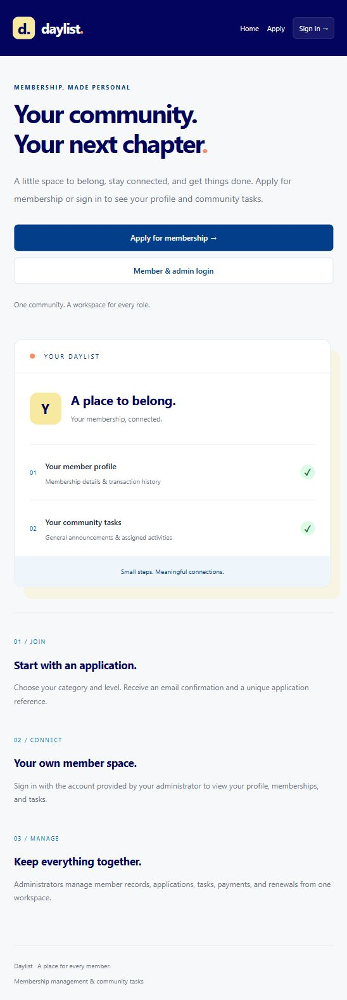
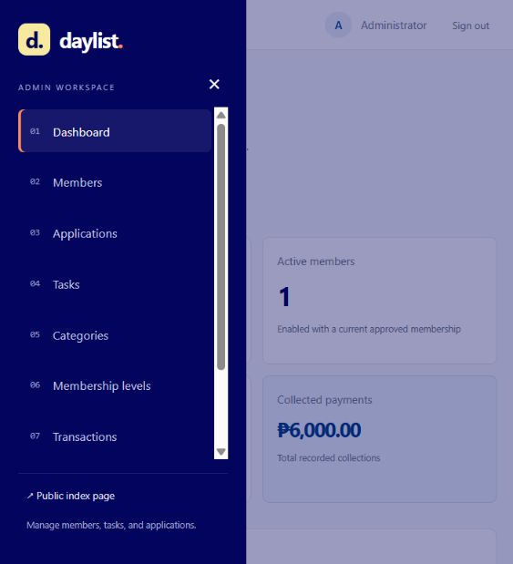
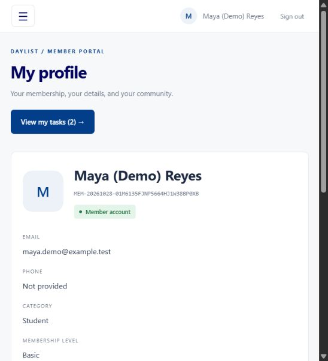
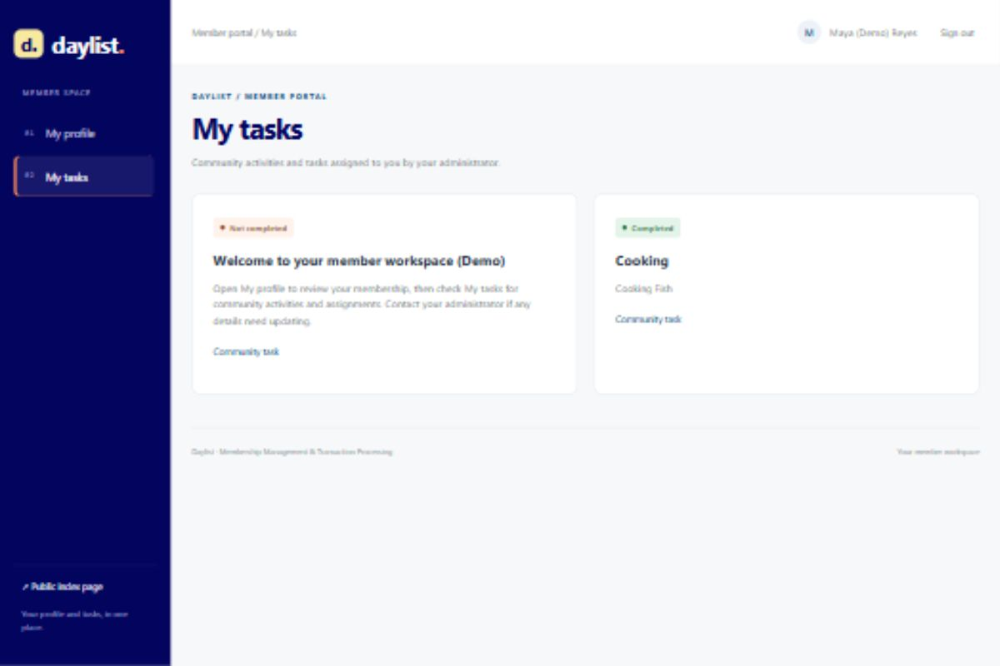

# Email, Maps, Weather, and Member Portal

This continuation implements the professor's email/maps/weather tutorial inside the existing Laravel 12 / PHP 8.2 project. It preserves `laravel_tasks`, existing memberships/payments, and saved tasks rather than creating the tutorial's separate `memberhub` project. The existing category/level split remains normalized; applications reference both and preserve the quoted level fee.

## Personal tasks

Members can now use **My tasks → Add a personal task**, with a title, optional description, and optional due date. Each personal task has Edit, Mark as complete/incomplete, and Delete controls. Ownership is set by the server; members cannot reassign their personal tasks or use these endpoints to modify administrator-created tasks. Existing community/assigned tasks remain available alongside the personal list.

Run `php artisan migrate` when updating another installation. The additive migration marks existing tasks as administrator-managed (`is_personal=false`) and preserves all existing task records. The refreshed SQL snapshot includes the new column and migration record.

## Status page

Administrator sidebar item **09 / Status** now opens `/status`. It shows the selected mailer, SMTP host/port, connection mode, masked sender address, queue counts, last processed application email, and Maps/weather configuration readiness. **Check SMTP connection** verifies the configured connection/authentication without sending an email. Results have a timestamp, are stored for the current administrator session, and are invalidated if mail settings change. No passwords or API keys are displayed. The old `/integrations` address redirects to Status.

## What is working now

- The site root `/` is a public index page. It stays an index even when someone is already signed in.
- Administrators use `/dashboard` and manage members, applications, categories, levels, transactions, payments, and task CRUD.
- The same `/login` form accepts administrator and enabled member accounts. Members are sent to `/portal/profile`; administrators are sent to `/dashboard`.
- Member profiles and task feeds are scoped to the logged-in account. Members cannot access the administration routes or another member's assigned tasks.
- Tasks without an assigned member are community tasks. Assigned administrator tasks are visible only to that member and administrators; their status is managed by administrators. Members can also add private personal tasks from My tasks, edit them, mark them complete/incomplete, and delete them. Personal tasks are excluded from other members' feeds, profile counts, and administrator task management.
- New member registration creates a linked user account. Enter a member password twice, or leave it blank to generate one. The credentials appear once on the resulting profile; share them privately.
- Older members: open their profile and use **Create member login**. The same section can reset a member password. Deactivation immediately prevents member portal access.
- `/membership/apply` saves a referenced application and optional consented coordinates, then queues a confirmation notification **after the database commits**.
- The confirmation email contains a signed link valid for seven days. Confirming email does not approve or pay for a membership.
- Application review is in the administrator's **Applications** sidebar. **Register as member** prefills the registration form and links the resulting member to the application. This cannot be done twice.
- The mobile menu opens a populated, scrollable sidebar with the correct navigation for each role. Desktop navigation remains visible. Escape and the close button close the mobile drawer.
- The map and weather components are wired up. Until provider keys are configured, they show setup messages and accept manually entered coordinates.

## Open the project

With XAMPP Apache and MySQL running:

```text
http://localhost/myproject/public/
```

If Apache is unavailable, start MySQL and run `php artisan serve`. Open `http://127.0.0.1:8000/`. Set `APP_URL` to the address actually being used so emailed confirmation links point to the correct server.

The existing administrator credentials are unchanged. The local database/SQL snapshot has this fictional demonstration member:

```text
Email: maya.demo@example.test
Password: member123
```

The `example.test` address is for local login demonstration; it is not a real mailbox. The snapshot also has a fictional `Tutorial Demo Applicant` application and a welcome community task. Existing user-created records were preserved.

## 1. Understand the current email mode

The local `.env` uses `MAIL_MAILER=log`. This is intentional until an SMTP provider is configured: emails are recorded in `storage/logs/laravel.log`, not delivered to an inbox.

Run the queue worker in a separate terminal:

```powershell
php artisan queue:work --tries=3
```

Submit a fictional application using an `example.test` address. Open the Laravel log and find **Membership application received**, the reference, and its signed confirmation URL. Open that URL to test confirmation locally. The log contains private message details and signed links; keep it out of the submission/repository.

The application's **Mail transport processed** timestamp is set only when the notification's mail channel finishes. With the log driver, this means it was written locally, not delivered to an inbox. **Email confirmed** is a separate timestamp recorded only after the signed link is opened.

### Option A: Local test inbox with Mailpit

Install/run Mailpit separately using its official instructions. It is not installed or started by this change. With Mailpit using its usual local ports, change `.env` to:

```dotenv
MAIL_MAILER=smtp
MAIL_SCHEME=smtp
MAIL_HOST=127.0.0.1
MAIL_PORT=1025
MAIL_USERNAME=null
MAIL_PASSWORD=null
MAIL_FROM_ADDRESS="no-reply@daylist.test"
MAIL_FROM_NAME="Daylist Membership"
QUEUE_CONNECTION=database
```

Open Mailpit's local inbox (normally `http://localhost:8025`) after submitting an application and processing the queue. This captures emails locally; it does not deliver to real recipients.

### Option B: Gmail or another SMTP provider

Use the host, port, username, and app password supplied by your provider. For the Gmail approach in the tutorial, enable 2-Step Verification and create a Google App Password yourself; do not use your normal Gmail password. Example:

```dotenv
MAIL_MAILER=smtp
MAIL_SCHEME=smtp
MAIL_HOST=smtp.gmail.com
MAIL_PORT=587
MAIL_USERNAME="your-address@gmail.com"
MAIL_PASSWORD="your-google-app-password"
MAIL_FROM_ADDRESS="your-address@gmail.com"
MAIL_FROM_NAME="Daylist Membership"
```

Laravel 12's SMTP configuration uses `MAIL_SCHEME`; Symfony Mailer negotiates STARTTLS for a supporting SMTP server. Keep credentials in `.env`, which is excluded from Git. Test with your own recipient address after setup.

## 2. Set up Google Maps

1. Open Google Cloud Console and create/select your own project.
2. Enable billing and **Maps JavaScript API**. Review provider pricing before enabling billing.
3. Create a browser API key.
4. Restrict its application use to **Websites / HTTP referrers**, matching the origins you actually use. Examples:

   ```text
   http://localhost/myproject/public/*
   http://127.0.0.1:8000/*
   ```

5. Restrict its API use to **Maps JavaScript API**.
6. Add the browser key to `.env`:

   ```dotenv
   GOOGLE_MAPS_KEY=your-restricted-browser-key
   ```

7. Clear configuration, reload the form, check the location consent box, then click **Load map & weather**.

The browser must receive the Google Maps key to load its JavaScript API; referrer/API restrictions protect it. The map starts at Manila (14.5995, 120.9842). Click a point to update coordinates and weather. Manual coordinate entry also works. Without a valid key, the component displays a setup/authentication error rather than an empty map with no explanation.

## 3. Set up OpenWeather

1. Create an OpenWeather account and confirm its email address.
2. Obtain a key with access to **Current Weather Data**.
3. Add it to `.env`:

   ```dotenv
   OPENWEATHER_KEY=your-server-key
   ```

4. Clear configuration and reload the application form. Select coordinates and click **Load map & weather**.

The browser calls this application's `/weather` endpoint; Laravel calls OpenWeather over HTTPS with latitude, longitude, and metric units. The OpenWeather key is never rendered into HTML/JavaScript or returned to the browser. Responses expose only place, temperature, condition description, and humidity. Requests are validated, rate-limited, and cached for five minutes at rounded coordinates. Public form requests use an expiring signed endpoint URL; signed-in users can use the authenticated request path.

Missing keys, invalid provider responses, and network timeouts produce clear messages. Live map rendering and real current weather cannot be verified until your own valid keys are configured. The automated tests use mocked provider responses and also verify missing-key/error behavior.

## 4. Apply configuration changes

```powershell
php artisan config:clear
php artisan queue:restart
```

Start/restart the queue worker if needed. Queue workers keep configuration in memory. Do not paste secret keys or SMTP passwords into Blade, JavaScript, screenshots, or Git.

## 5. Canvas hosting (deferred)

Hosting is intentionally deferred until you provide the PHP/MySQL hosting details. No public URL has been created. A localhost URL works only on your own computer and is not a Canvas submission link your professor can open remotely.

When hosting is available:

- Use a PHP 8.2+ host with MySQL/MariaDB and a queue worker.
- Point the web/document root at `public/`, not the repository root.
- Set the final HTTPS `APP_URL`, production database/SMTP settings, `APP_ENV=production`, and `APP_DEBUG=false`.
- Run `php artisan migrate --force` and supervise `php artisan queue:work`.
- Add the real domain to the Google Maps key's allowed referrers.
- Replace classroom/demo login credentials before exposing real member records publicly.
- Submit the domain's root URL. `/` now renders the index page directly; it does not redirect to the dashboard or login.

## Checks performed

The feature suite covers member login/isolation, member provisioning, administrative task CRUD, assigned/general task visibility, application validation, signed confirmation, protected/cached weather responses, missing-key handling, and role-specific sidebar links. A database-backed queue test verifies that rolled-back applications leave no email job and that the processed timestamp is not set before the worker runs.

Live browser checks covered the index, demo application submission, the admin menu, member login/profile/tasks, and the populated mobile sidebar. A demo application's queued notification was processed using the **local log mailer**. This is not a claim of delivery to a real inbox or a live provider API test.

## Screenshots









## References

- Professor's supplied `Laravel_Membership_Email_Maps_Weather_Tutorial.pdf`.
- [Laravel 12 notifications](https://laravel.com/docs/12.x/notifications).
- [Google Maps JavaScript API loading](https://developers.google.com/maps/documentation/javascript/load-maps-js-api).
- [Google Maps key setup and restrictions](https://developers.google.com/maps/documentation/javascript/get-api-key).
- [OpenWeather Current Weather API](https://openweathermap.org/current).
- [Mailpit installation](https://mailpit.axllent.org/docs/install/).
